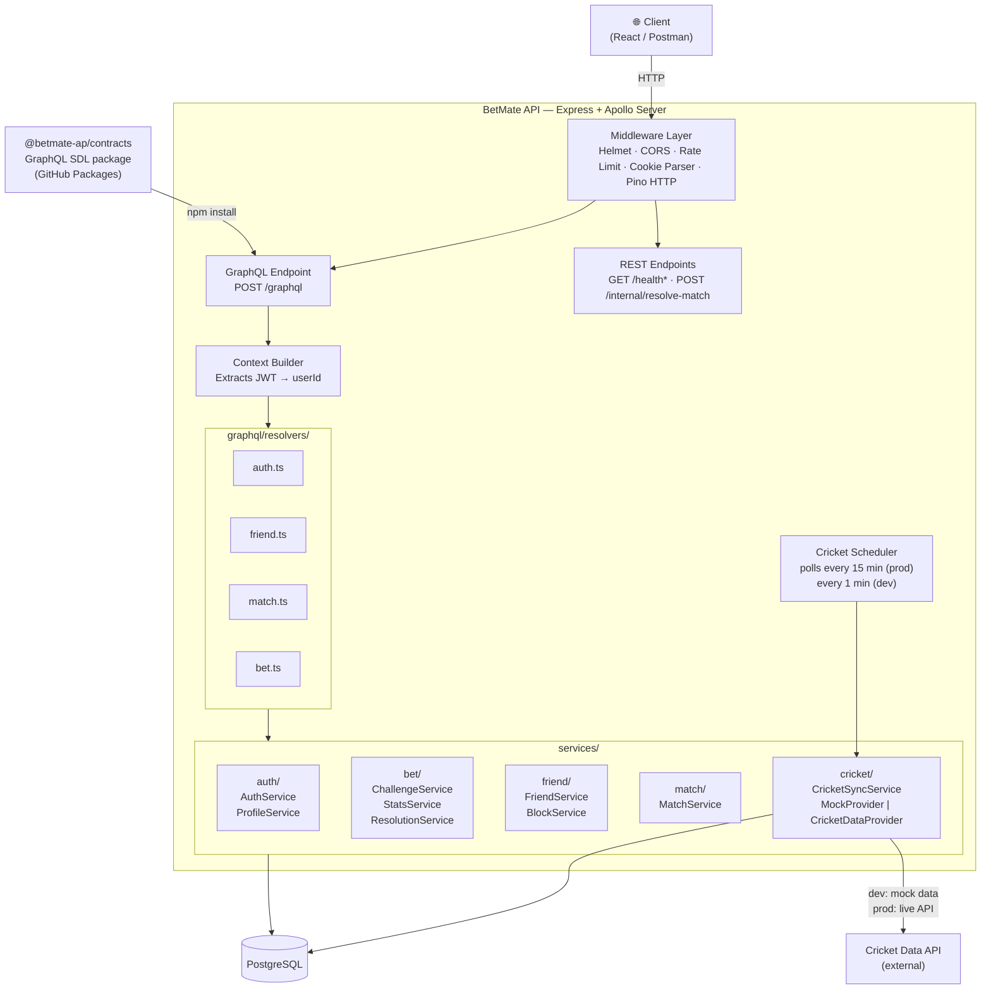
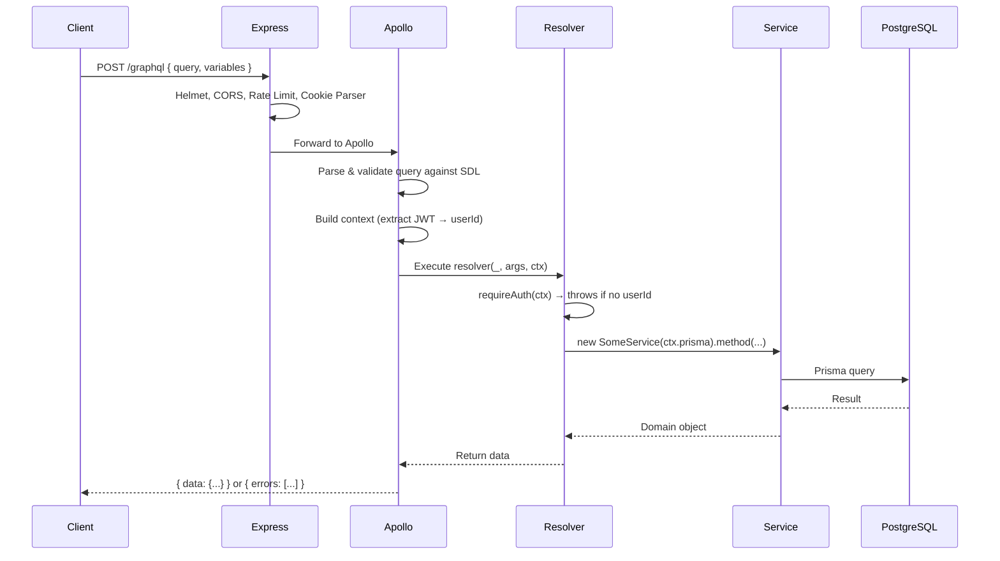
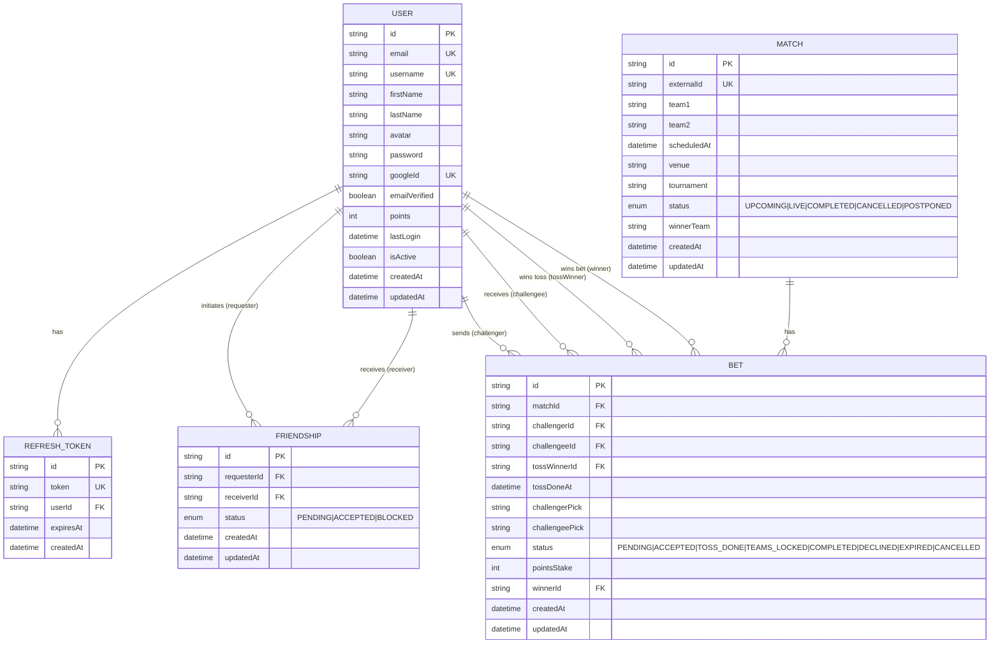
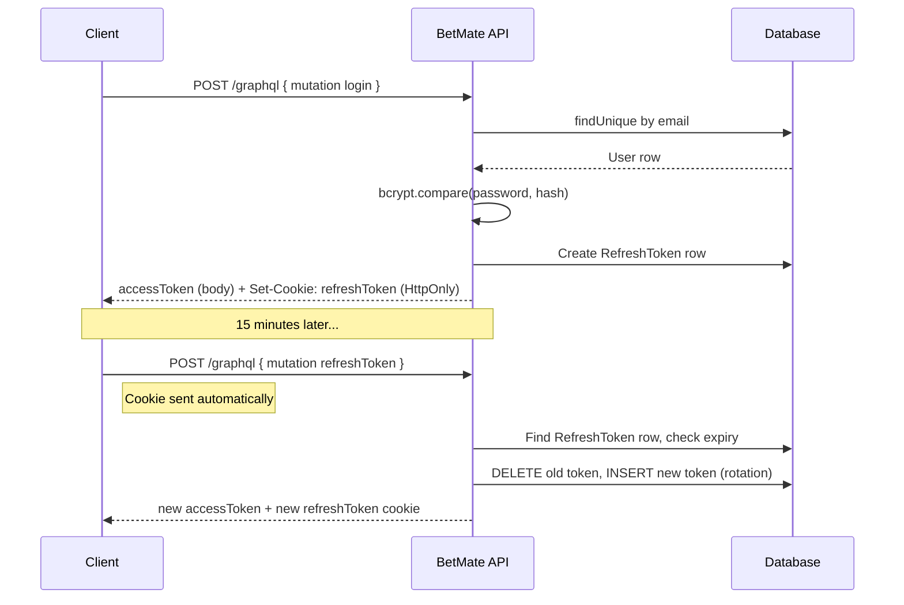
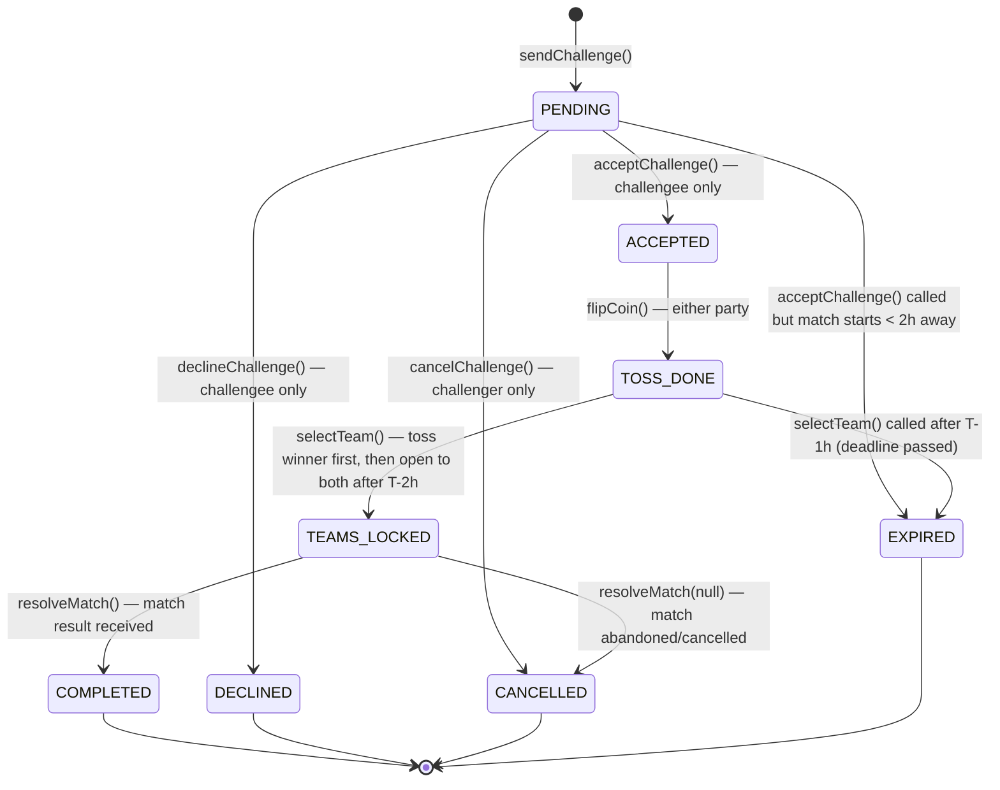
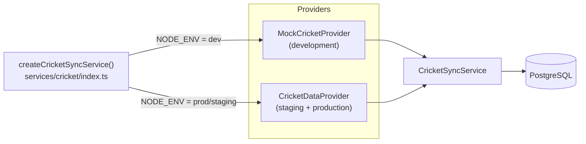
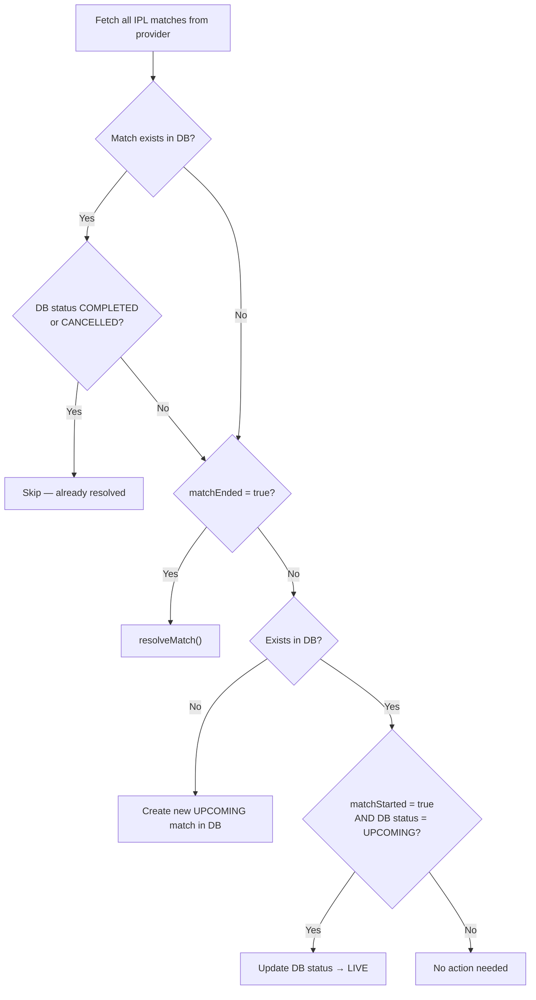

# BetMate API — Backend Documentation

> **The complete technical reference for the BetMate backend.** If you're picking this project back up, onboarding a new developer, or building the frontend — start here.

---

## Table of Contents

1. [What is BetMate?](#1-what-is-betmate)
2. [Tech Stack](#2-tech-stack)
3. [System Architecture](#3-system-architecture)
4. [Project Structure](#4-project-structure)
5. [Data Model](#5-data-model)
6. [Authentication System](#6-authentication-system)
7. [GraphQL API Reference](#7-graphql-api-reference)
8. [Service Layer](#8-service-layer)
9. [Bet Lifecycle](#9-bet-lifecycle)
10. [Team Selection Rules (T-2h / T-1h)](#10-team-selection-rules-t-2h--t-1h)
11. [Cricket Sync System](#11-cricket-sync-system)
12. [Error Codes Reference](#12-error-codes-reference)
13. [Deployment](#13-deployment)
14. [Schema Contract (betmate-contracts)](#14-schema-contract-betmate-contracts)

---

## 1. What is BetMate?

BetMate is a **friend-to-friend IPL betting app** built around social engagement. Users challenge each other on upcoming IPL matches, flip a coin to decide who picks first, select their team, and earn (or lose) points when the match result comes in.

**Core loop:**

```
Add a friend → Challenge them on a match → Flip coin → Pick your team → Win or lose 10 points
```

There is no real money involved. Points are the only currency.

---

## 2. Tech Stack

| Layer            | Technology            | Version | Why                                               |
| ---------------- | --------------------- | ------- | ------------------------------------------------- |
| Runtime          | Node.js               | 20+     | LTS, excellent ecosystem                          |
| Language         | TypeScript            | 5.x     | Type safety across the whole stack                |
| HTTP Framework   | Express               | v5      | Stable, minimal, pairs well with Apollo           |
| GraphQL Server   | Apollo Server         | v4      | Industry standard, built-in sandbox               |
| ORM              | Prisma                | v6      | Type-safe DB access, great migrations             |
| Database         | PostgreSQL            | 15+     | Relational, reliable, Railway native              |
| Auth             | JWT (jsonwebtoken)    | —       | Stateless access tokens + rotating refresh tokens |
| Password Hashing | bcryptjs              | —       | Industry standard, SALT_ROUNDS = 12               |
| Logging          | pino + pino-pretty    | —       | Structured JSON logs in prod, pretty in dev       |
| Error Tracking   | Sentry                | —       | Optional, auto-captures uncaught errors           |
| Schema Package   | @betmate-ap/contracts | 0.1.4+  | Shared GraphQL SDL published to GitHub Packages   |
| Deployment       | Railway               | —       | Multi-environment (staging + production)          |
| Container        | Docker                | —       | Local dev DB via docker-compose                   |

---

## 3. System Architecture



### Request Flow



---

## 4. Project Structure

```
betmate-api/
├── src/
│   ├── app.ts                    # Express app factory, Apollo setup, middleware
│   ├── index.ts                  # Entry point, server listen
│   │
│   ├── constants/
│   │   ├── bet.ts                # POINTS_STAKE, challenge window hours
│   │   └── iplTeams.ts           # IPL team metadata (name, abbreviation, ground)
│   │
│   ├── graphql/
│   │   ├── context.ts            # Context type + requireAuth() helper
│   │   ├── loadSchema.ts         # Loads SDL from @betmate-ap/contracts
│   │   └── resolvers/
│   │       ├── index.ts          # Merges all domain resolvers → exports `resolvers`
│   │       ├── auth.ts           # signup, login, logout, refreshToken, profile mutations
│   │       ├── bet.ts            # challenge lifecycle, coin flip, team selection, queries
│   │       ├── friend.ts         # betmate requests, block/unblock, search
│   │       └── match.ts          # matches query, match query
│   │
│   ├── lib/
│   │   ├── auth.ts               # JWT extraction from headers/cookies
│   │   ├── config.ts             # Typed env var config (throws on missing required vars)
│   │   ├── cricketScheduler.ts   # Polling scheduler (15 min prod / 1 min dev)
│   │   ├── logger.ts             # pino logger (pretty in dev, JSON in prod)
│   │   ├── monitoring.ts         # PerformanceMonitor, HealthChecker, ErrorTracker
│   │   ├── prisma.ts             # Prisma client singleton
│   │   └── sentry.ts             # Sentry init
│   │
│   ├── services/
│   │   ├── auth/
│   │   │   ├── auth.service.ts   # signup, login, refreshToken, logout
│   │   │   ├── profile.service.ts# getUserById, updateProfile, changePassword
│   │   │   ├── types.ts          # Auth interfaces + sanitizeUser()
│   │   │   └── index.ts          # Barrel export
│   │   ├── bet/
│   │   │   ├── challenge.service.ts # sendChallenge, accept/decline/cancel, flipCoin, selectTeam, getMyBets
│   │   │   ├── stats.service.ts     # getHeadToHead, getLeaderboard
│   │   │   ├── resolution.service.ts# resolveMatch (called by cricket sync + REST endpoint)
│   │   │   └── index.ts
│   │   ├── friend/
│   │   │   ├── friend.service.ts    # searchUsers, friend request CRUD, getMyBetmates
│   │   │   ├── block.service.ts     # blockUser, unblockUser, getBlockedUsers
│   │   │   └── index.ts
│   │   ├── match/
│   │   │   └── index.ts             # getMatches, getMatch
│   │   └── cricket/
│   │       ├── index.ts             # Factory: creates sync service with correct provider
│   │       ├── types.ts             # CricketProvider interface, ExternalMatch type
│   │       ├── syncService.ts       # CricketSyncService (processes & upserts matches)
│   │       ├── mockProvider.ts      # MockCricketProvider (6 deterministic IPL scenarios)
│   │       └── cricketDataProvider.ts # CricketDataProvider (live API, prod only)
│   │
│   └── utils/
│       └── crypto.ts               # CryptoUtils: hash, compare, JWT sign/verify
│
├── prisma/
│   └── schema.prisma               # Database schema (User, Match, Bet, Friendship, RefreshToken)
│
├── postman/
│   └── betmate-api.postman_collection.json
│
├── docs/
│   └── BACKEND.md                  # ← You are here
│
├── docker-compose.yml              # Local PostgreSQL container
├── Dockerfile                      # Production container
└── railway.json / railway.*.json   # Railway deployment config per environment
```

---

## 5. Data Model



### Key Design Decisions

| Decision                                                       | Why                                                                                                                         |
| -------------------------------------------------------------- | --------------------------------------------------------------------------------------------------------------------------- |
| `Friendship` reused for blocks                                 | A block replaces the friendship row, preserving directional info (`requesterId` = blocker). No separate Block table needed. |
| `Bet.challengerPick` / `Bet.challengeePick` set simultaneously | When one player picks, the other gets the remaining team automatically. Prevents race conditions via DB unique constraint.  |
| `externalId` on `Match`                                        | Idempotent upsert during cricket sync — same match won't be created twice.                                                  |
| `RefreshToken` stored in DB                                    | Enables true revocation (logout, password change, etc.) rather than waiting for token expiry.                               |

---

## 6. Authentication System

BetMate uses a **dual-token** strategy:

- **Access Token** — short-lived (15 min), sent in `Authorization: Bearer <token>` header. Used for every authenticated request.
- **Refresh Token** — long-lived (7 days), sent as an `HttpOnly` cookie (`refreshToken`). Used only to issue new access tokens.

### Login Flow



### Token Rotation

Every call to `refreshToken` **deletes the old refresh token and issues a brand new one**. This means:

- A stolen refresh token can only be used once before it's invalidated
- `changePassword` deletes **all** refresh tokens for the user — forcing re-login on every device

### Context Building

On every GraphQL request, Apollo calls the context function before any resolver runs:

```
Request headers / cookies
       ↓
extractTokenFromRequest()      — checks Authorization header, then accessToken cookie
       ↓
getUserFromToken()             — verifies JWT, checks type === "access"
       ↓
ctx.user = { userId }          — or null if no/invalid token
```

Resolvers that require auth call `requireAuth(ctx)`, which throws `UNAUTHENTICATED` if `ctx.user` is null.

---

## 7. GraphQL API Reference

The full schema lives in `@betmate-ap/contracts`. Below is a human-readable summary.

### Queries

| Query                   | Auth | Description                                                            |
| ----------------------- | ---- | ---------------------------------------------------------------------- |
| `health`                | No   | Returns `"ok"`. Liveness probe.                                        |
| `me`                    | Yes  | Returns the current user's profile.                                    |
| `myBetmates`            | Yes  | Returns all accepted Betmates.                                         |
| `pendingFriendRequests` | Yes  | Friend requests received, not yet actioned.                            |
| `sentFriendRequests`    | Yes  | Friend requests sent by the current user.                              |
| `blockedUsers`          | Yes  | Users the current user has blocked.                                    |
| `searchUsers(query)`    | Yes  | Search by name/username. Blocked users are hidden from results.        |
| `matches(status?)`      | Yes  | All matches, optionally filtered by status (`UPCOMING`, `LIVE`, etc.). |
| `match(id)`             | Yes  | Single match by ID.                                                    |
| `myBets(status?)`       | Yes  | All bets the current user is a party to.                               |
| `headToHead(betmateId)` | Yes  | Win/loss record and net points vs a specific Betmate.                  |
| `leaderboard`           | Yes  | Current user + all Betmates ranked by points.                          |

### Mutations

#### Auth

| Mutation                | Auth | Description                                                  |
| ----------------------- | ---- | ------------------------------------------------------------ |
| `signup(input)`         | No   | Create account, returns tokens.                              |
| `login(input)`          | No   | Authenticate, returns tokens.                                |
| `logout`                | No   | Deletes refresh token from DB, clears cookie.                |
| `refreshToken`          | No   | Issues new tokens using the refresh cookie (token rotation). |
| `updateProfile(input)`  | Yes  | Update firstName, lastName, or username. Partial update.     |
| `changePassword(input)` | Yes  | Change password. Invalidates all sessions.                   |
| `sendVerificationEmail` | No   | _(stub — not yet implemented)_                               |
| `verifyEmail(token)`    | No   | _(stub — not yet implemented)_                               |
| `forgotPassword(email)` | No   | _(stub — not yet implemented)_                               |
| `resetPassword(input)`  | No   | _(stub — not yet implemented)_                               |

#### Betmates (Friends)

| Mutation                             | Auth | Description                                                |
| ------------------------------------ | ---- | ---------------------------------------------------------- |
| `sendFriendRequest(userId)`          | Yes  | Send a Betmate request.                                    |
| `acceptFriendRequest(friendshipId)`  | Yes  | Accept a pending request. Recipient only.                  |
| `declineFriendRequest(friendshipId)` | Yes  | Decline and delete the request. Recipient only.            |
| `removeBetmate(userId)`              | Yes  | Remove an accepted Betmate relationship.                   |
| `blockUser(userId)`                  | Yes  | Block a user. Converts existing friendship row to BLOCKED. |
| `unblockUser(userId)`                | Yes  | Remove block (deletes friendship row).                     |

#### Bets

| Mutation                  | Auth | Description                                                                 |
| ------------------------- | ---- | --------------------------------------------------------------------------- |
| `sendChallenge(input)`    | Yes  | Create a bet challenge. Only valid on UPCOMING matches > 2h away.           |
| `acceptChallenge(betId)`  | Yes  | Accept a pending challenge. Challengee only. Auto-expires if < 2h to match. |
| `declineChallenge(betId)` | Yes  | Decline a pending challenge. Challengee only.                               |
| `cancelChallenge(betId)`  | Yes  | Cancel a pending challenge. Challenger only.                                |
| `flipCoin(betId)`         | Yes  | Flip the virtual coin. Either party can flip.                               |
| `selectTeam(input)`       | Yes  | Lock in team picks. Assigns opposite team to opponent automatically.        |

---

## 8. Service Layer

### `services/auth/`

| Service          | Responsibilities                                                                                                                              |
| ---------------- | --------------------------------------------------------------------------------------------------------------------------------------------- |
| `AuthService`    | `signup`, `login`, `refreshToken`, `logout` — all token lifecycle operations. Validates input, hashes passwords, manages `RefreshToken` rows. |
| `ProfileService` | `getUserById`, `updateProfile`, `changePassword` — user data management. `changePassword` invalidates all existing sessions.                  |

**`types.ts`** contains all exported interfaces (`SignupInput`, `LoginInput`, `AuthPayload`, etc.) and the shared `sanitizeUser()` helper that strips the password field and serialises dates to ISO strings.

---

### `services/bet/`

| Service             | Responsibilities                                                                                                                                                                                     |
| ------------------- | ---------------------------------------------------------------------------------------------------------------------------------------------------------------------------------------------------- |
| `ChallengeService`  | The full challenge lifecycle: `sendChallenge`, `acceptChallenge`, `declineChallenge`, `cancelChallenge`, `flipCoin`, `selectTeam`, `getMyBets`. Also contains the private `findBetOrThrow()` helper. |
| `StatsService`      | `getHeadToHead`, `getLeaderboard` — read-only analytics.                                                                                                                                             |
| `ResolutionService` | `resolveMatch` — called by the cricket sync service and the internal REST endpoint. Settles all `TEAMS_LOCKED` bets in a single transaction.                                                         |

**Constants** (`src/constants/bet.ts`):

| Constant                           | Value | Meaning                                                                                      |
| ---------------------------------- | ----- | -------------------------------------------------------------------------------------------- |
| `POINTS_STAKE`                     | `10`  | Points won/lost per settled bet                                                              |
| `TEAM_PICK_EXCLUSIVE_WINDOW_HOURS` | `2`   | How long before the match challenges are blocked and toss winner has exclusive pick priority |
| `TEAM_PICK_DEADLINE_HOURS`         | `1`   | How long before the match all team selection closes (bet expires if not picked)              |

---

### `services/friend/`

| Service         | Responsibilities                                                                                                                                                                                  |
| --------------- | ------------------------------------------------------------------------------------------------------------------------------------------------------------------------------------------------- |
| `FriendService` | `searchUsers` (excludes blocked users), `sendFriendRequest`, `acceptFriendRequest`, `declineFriendRequest`, `removeBetmate`, `getMyBetmates`, `getPendingFriendRequests`, `getSentFriendRequests` |
| `BlockService`  | `blockUser` (upserts existing friendship row to BLOCKED), `unblockUser`, `getBlockedUsers`                                                                                                        |

**Important:** `searchUsers` excludes users who have blocked you **or** whom you have blocked. Both directions are filtered.

---

### `services/match/`

Thin wrapper around Prisma for match reads. Match writes are handled exclusively by `CricketSyncService` and `ResolutionService` — no public mutations exist for match creation.

---

### `services/cricket/`

See [Section 11](#11-cricket-sync-system) for the full breakdown.

---

## 9. Bet Lifecycle

A bet moves through a strict state machine. Not every transition is valid — the service layer enforces this.



### Terminal States

| Status      | Who sets it                       | Meaning                                                  |
| ----------- | --------------------------------- | -------------------------------------------------------- |
| `COMPLETED` | `ResolutionService`               | Match done, points transferred                           |
| `DECLINED`  | Challengee                        | Challenge rejected                                       |
| `CANCELLED` | Challenger OR `ResolutionService` | Voluntarily cancelled, or match abandoned                |
| `EXPIRED`   | System                            | Either never accepted, or teams never picked before T-1h |

### Re-challenging

After a terminal state (`DECLINED`, `EXPIRED`, `CANCELLED`), the same pair **can** send a new challenge on the same match. Only one **active** bet per pair per match is enforced.

---

## 10. Team Selection Rules (T-2h / T-1h)

The time-based rules are the most complex part of the bet flow. Here is the complete timeline:

```
Match scheduled at T
│
├─── T - ∞  to  T - 2h  ──────────────────────────────────────────────────────┐
│   ✅ Challenges can be sent                                                   │
│   ✅ Challenges can be accepted                                                │
│   ✅ Toss winner has EXCLUSIVE team pick priority                             │
│                                                                               │
├─── T - 2h  ──────────────────────────────────────────────────────────────────┤
│   🔒 New challenges blocked (MATCH_TOO_SOON)                                  │
│   🔒 Pending challenges auto-expire on accept attempt                         │
│   🔓 BOTH players can now pick a team (window opens to everyone)              │
│      First-write-wins: whoever calls selectTeam() first, their pick is locked │
│                                                                               │
├─── T - 1h  ──────────────────────────────────────────────────────────────────┤
│   🔒 Team selection window CLOSES — bet expires if teams not locked            │
│                                                                               │
└─── T  (Match starts) ────────────────────────────────────────────────────────┘
    🏏 Match goes LIVE
    📊 Cricket sync detects result → resolveMatch() called
    🏆 TEAMS_LOCKED bets → COMPLETED, points transferred
    💀 PENDING/ACCEPTED/TOSS_DONE bets → EXPIRED
```

**Why the T-2h window opens to both players:**
The toss winner has had exclusive priority for the entire period before T-2h. If they haven't picked by T-2h, both players get a chance to lock in picks before the deadline. The database `@@unique([matchId, challengerId, challengeeId])` constraint prevents any race condition — only one write can succeed.

---

## 11. Cricket Sync System

BetMate does not require manual match creation. The **cricket sync service** polls a cricket data API (or a mock in development) and automatically creates, updates, and resolves matches.

### Provider Pattern



Swapping providers is a zero-code change — just set the environment.

### Sync Logic (per match)



### Mock Scenarios (Development)

The mock provider returns 6 deterministic scenarios on every call. Upcoming match times are **recomputed fresh** on every call so they never expire:

| Scenario | Match      | Status                | Hours from now |
| -------- | ---------- | --------------------- | -------------- |
| A        | MI vs CSK  | Upcoming              | +5h            |
| B        | RCB vs KKR | Upcoming              | +26h           |
| C        | SRH vs RR  | Live                  | −1h            |
| D        | GT vs LSG  | Completed (GT wins)   | −5h            |
| E        | DC vs PBKS | Completed (PBKS wins) | −6h            |
| F        | MI vs RCB  | Abandoned             | −8h            |

**Note:** Scenario A may enter the challenge-blocked window (T-2h) if the server has been running for 3+ hours. Use Scenario B's match for happy-path testing.

### Polling Intervals

| Environment          | Interval         | Reason                                 |
| -------------------- | ---------------- | -------------------------------------- |
| Development          | Every 1 minute   | Quickly exercise all mock scenarios    |
| Staging / Production | Every 15 minutes | 96 calls/day — within free tier limits |

### Match Resolution

`resolveMatch(matchId, winnerTeam)` runs inside a **single database transaction**:

1. Expire all `PENDING`, `ACCEPTED`, `TOSS_DONE` bets
2. If no winner (match abandoned) → cancel all `TEAMS_LOCKED` bets, set match to `CANCELLED`
3. Otherwise → for each `TEAMS_LOCKED` bet: determine winner, transfer `POINTS_STAKE` points, set bet to `COMPLETED`, set match to `COMPLETED`

---

## 12. Error Codes Reference

All GraphQL errors include an `extensions.code` field. Frontend should handle these explicitly:

### Auth Errors

| Code                    | Trigger                                    |
| ----------------------- | ------------------------------------------ |
| `UNAUTHENTICATED`       | Missing or invalid access token            |
| `INVALID_CREDENTIALS`   | Wrong email/password                       |
| `EMAIL_ALREADY_EXISTS`  | Email taken on signup                      |
| `USERNAME_TAKEN`        | Username taken on signup or profile update |
| `INVALID_EMAIL`         | Malformed email on signup                  |
| `INVALID_USERNAME`      | Username < 3 or > 30 chars                 |
| `INVALID_NAME`          | Empty first or last name                   |
| `WEAK_PASSWORD`         | Password < 8 chars                         |
| `SAME_PASSWORD`         | New password same as current               |
| `ACCOUNT_DEACTIVATED`   | Account is soft-deleted                    |
| `INVALID_REFRESH_TOKEN` | Bad or expired refresh token               |
| `REFRESH_TOKEN_EXPIRED` | Refresh token past expiry                  |
| `USER_NOT_FOUND`        | User lookup by ID failed                   |

### Friend / Block Errors

| Code               | Trigger                                         |
| ------------------ | ----------------------------------------------- |
| `ALREADY_BETMATES` | Sending a request to an existing Betmate        |
| `REQUEST_PENDING`  | Request already exists in either direction      |
| `BLOCKED`          | One of the users has blocked the other          |
| `NOT_FOUND`        | Friendship record not found                     |
| `FORBIDDEN`        | Caller is not the correct party for this action |
| `INVALID_STATUS`   | Friendship is not in the expected status        |

### Bet Errors

| Code                      | Trigger                                                 |
| ------------------------- | ------------------------------------------------------- |
| `NOT_BETMATES`            | Trying to challenge a non-Betmate                       |
| `MATCH_NOT_UPCOMING`      | Match is not in UPCOMING status                         |
| `MATCH_TOO_SOON`          | Match starts within 2 hours                             |
| `BET_EXISTS`              | Active bet already exists for this pair and match       |
| `CHALLENGE_EXPIRED`       | Challenge auto-expired because match is now < 2h away   |
| `SELECTION_WINDOW_CLOSED` | Team selection attempted after T-1h                     |
| `NOT_TOSS_WINNER`         | Non-toss-winner trying to pick before T-2h window opens |
| `INVALID_TEAM`            | Team name doesn't match either match team               |
| `INVALID_STATUS`          | Bet is not in the required status for this action       |
| `FORBIDDEN`               | Caller is not a party to this bet, or wrong role        |
| `ALREADY_RESOLVED`        | Match is already COMPLETED or CANCELLED                 |

---

## 13. Deployment

BetMate API is deployed on **Railway** with separate environments.

### Environments

| Environment | Branch                  | URL                                                  |
| ----------- | ----------------------- | ---------------------------------------------------- |
| Staging     | `main`                  | `https://betmate-api-staging-staging.up.railway.app` |
| Production  | `main` (manual promote) | TBD                                                  |

### How Deploys Work

1. PR merged to `main` → Railway auto-deploys to staging
2. `prestart` script runs `prisma migrate deploy` before the server starts — migrations are always applied automatically
3. No manual migration steps needed

### Required Environment Variables (Railway)

| Variable                | Required | Description                                                            |
| ----------------------- | -------- | ---------------------------------------------------------------------- |
| `DATABASE_URL`          | ✅       | PostgreSQL connection string (Railway provides this)                   |
| `JWT_SECRET`            | ✅       | Strong random secret for signing JWTs                                  |
| `NODE_AUTH_TOKEN`       | ✅       | GitHub PAT for installing `@betmate-ap/contracts` from GitHub Packages |
| `NODE_ENV`              | ✅       | `staging` or `production`                                              |
| `CORS_ORIGIN`           | ✅       | Frontend URL (e.g. `https://betmate-app.vercel.app`)                   |
| `SENTRY_DSN`            | ⬜       | Optional. Sentry project DSN for error tracking                        |
| `CRICKET_API_KEY`       | ⬜       | Cricket data API key. If absent, sync is skipped with a warning        |
| `CRICKET_IPL_SERIES_ID` | ⬜       | IPL series ID from the cricket data API                                |

### Health Endpoints (for Railway probes)

| Endpoint               | Status     | Description                                     |
| ---------------------- | ---------- | ----------------------------------------------- |
| `GET /health`          | 200 always | Basic liveness — returns `"ok"`                 |
| `GET /healthz`         | 200 always | Railway liveness probe                          |
| `GET /livez`           | 200 always | Returns `"alive"`                               |
| `GET /readyz`          | 200 / 503  | Readiness — checks DB connectivity              |
| `GET /health/detailed` | 200        | JSON with DB latency, memory usage, system info |

### Internal Endpoints

| Endpoint                       | Auth                         | Description                                                                                              |
| ------------------------------ | ---------------------------- | -------------------------------------------------------------------------------------------------------- |
| `POST /internal/resolve-match` | None (IP-restricted in prod) | Manually resolve a match result. Body: `{ matchId, winnerTeam? }`. Used for testing and admin overrides. |

---

## 14. Schema Contract (betmate-contracts)

The GraphQL SDL lives in a **separate private repo** (`betmate-contracts`) and is published to GitHub Packages as `@betmate-ap/contracts`.

This separation means the schema is a single source of truth shared between:

- The API (validates all GraphQL operations against it)
- Future frontend tooling (can generate typed hooks/queries)

### Workflow for Schema Changes

```
1. Edit schema/index.graphql in betmate-contracts repo
2. Bump version in package.json (e.g. 0.1.4 → 0.1.5)
3. PR → merge to main
4. Manually trigger the "Release" GitHub Actions workflow
5. Package published to GitHub Packages
6. In betmate-api: npm install @betmate-ap/contracts@<new-version>
7. Update resolvers if new fields/types added
8. PR → merge
```

> ⚠️ The Release workflow is **manually triggered**, not auto-triggered on merge. Don't forget step 4.

### Current Version

`@betmate-ap/contracts@0.1.4`

Key types: `User`, `Match`, `Bet`, `Friendship`, `AuthPayload`, `LeaderboardEntry`, `HeadToHeadResult`, `UserSearchResult`

---

_Last updated: August 2025 — BetMate API v0.1.4_
